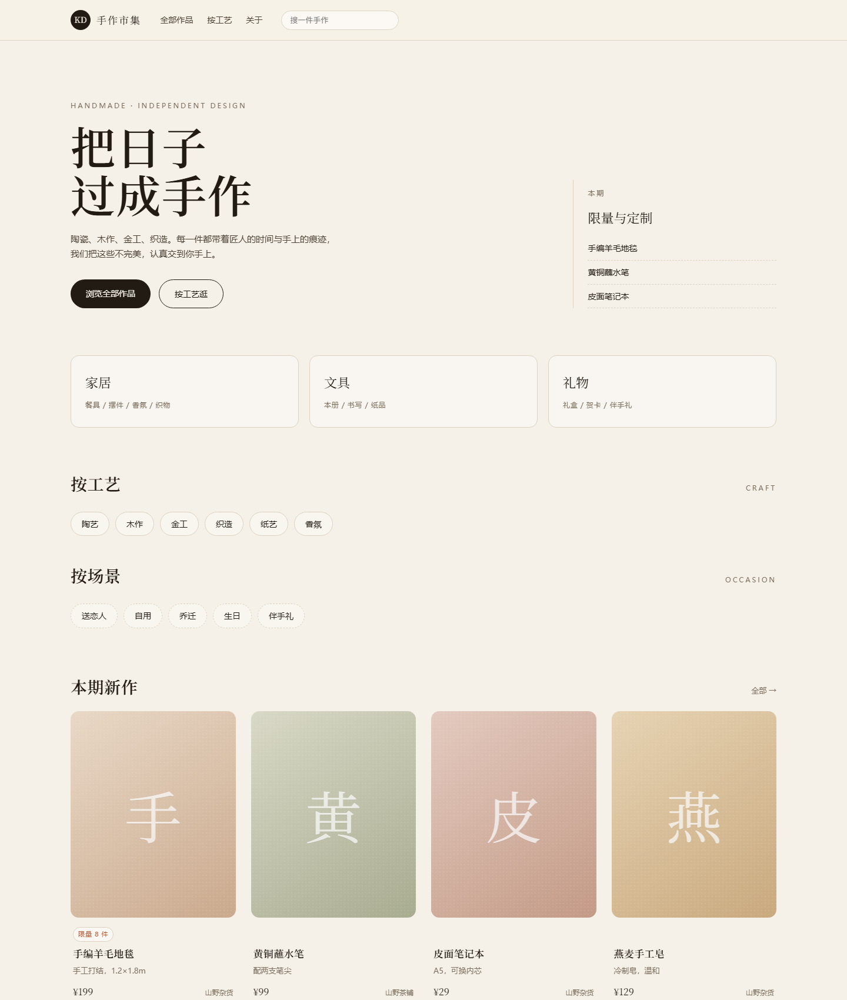

# KDShop · 多商家商城

一个可跑通、可演示的多商家电商平台：8 个通用类目 + 手作家居 / 文具 / 礼物三个特色专区，支持定金尾款、工期承诺与带质检的售后闭环。

> 当前状态：**开发中**。商品浏览、购物车、结算预览已可用；下单、支付、订单、商家与平台后台在推进中。功能进度以 [GitHub Issues](https://github.com/Serein47/KDShop/issues) 为准。



## 技术栈

| 层 | 选型 |
|---|---|
| 后端 | Spring Boot 3.5 · JDK 21 · MyBatis-Plus · Flyway · Spring Security（会话 + CSRF） |
| 前端 | Vue 3 · TypeScript · Vite · Pinia · Vue Router |
| 存储 | MySQL 8 · Redis 7（会话与限流）· MinIO（商品图）· Mailpit（邮件捕获） |
| 部署 | Docker Compose（基础设施）+ 阿里云（生产，待上线） |

## 快速开始

前置：Docker、JDK 21、Maven 3.9+、Node 20+。

```bash
# 1) 基础设施（MySQL / Redis / MinIO / Mailpit）
cd infra
cp .env.example .env
docker compose up -d

# 2) 后端（首次启动自动建表并写入演示数据）
cd ../backend
mvn -B -DskipTests package
java -jar target/kdshop-backend-0.1.0-SNAPSHOT.jar --spring.profiles.active=local

# 3) 前端
cd ../frontend
npm ci
npm run dev
```

打开 <http://localhost:5173>。默认端口：后端 8080、MySQL 3307、Redis 6380、MinIO 9000/9001、Mailpit 8025。

> 本机 3306 若已被占用，容器映射到 3307，后端默认就连 3307，可用 `DB_PORT` 覆盖。

## 演示账号

| 账号 | 口令 | 角色 |
|---|---|---|
| customer@kdshop.dev | Demo@123456 | 顾客 |
| merchant1@kdshop.dev | Demo@123456 | 商家（山野杂货） |
| merchant2@kdshop.dev | Demo@123456 | 商家（山野茶铺） |
| support@kdshop.dev | Demo@123456 | 客服 |
| operator@kdshop.dev | Demo@123456 | 平台运营 |
| admin@kdshop.dev | Demo@123456 | 管理员 |

> 演示环境统一口令；**生产部署前必须全部重置**，管理员口令由部署脚本单独生成（见 `docs/deployment.md`，待补）。

## 已实现 / 计划中

| 域 | 已完成 | 计划中 |
|---|---|---|
| 账号 | 注册、登录、登出、邮箱验证、重置密码、会话与 CSRF | — |
| 商品 | 类目树、三维标签筛选、详情（限量/孤品/故事/瑕疵说明）、店铺页 | 定制项参与下单 |
| 购物车 | 服务端与本地双模式、登录合并、库存校验 | — |
| 结算 | 按商家拆单、独立运费、优惠券分摊、地址簿 | 提交订单 |
| 交易 | — | 下单、模拟支付、订单状态机、超时取消 |
| 商家端 | — | 入驻、商品管理、发货、售后处理 |
| 平台端 | — | 商家审核、订单检索、结算、审计 |
| 差异化 | 数据模型与迁移已就位 | 定金尾款、工期赔付、退货质检、超时裁决 |

## 项目结构

```
backend/   Spring Boot 应用（含 Flyway 迁移与种子数据）
frontend/  Vue 3 前台
infra/     Docker Compose、端口与镜像说明
docs/      需求、数据模型、状态机、接口文档、ADR、Issue 拆分
scripts/   本地检查、Issue 批量创建、WSL 初始化
```

## 开发命令

```bash
# 一键检查（后端测试 + 前端构建）
powershell -NoProfile -ExecutionPolicy Bypass -File scripts\check.ps1

# 后端测试
cd backend && mvn -B test

# 前端类型检查 + 构建
cd frontend && npm run build

# UI 冒烟（需本机 Edge；先起后端 8081 与前端 5180）
cd frontend && npm run ui:check
```

## 文档

| 文档 | 内容 |
|---|---|
| [AGENTS.md](AGENTS.md) | 项目章程：范围、流程门禁、质量底线 |
| [docs/requirements.md](docs/requirements.md) | 需求与验收线 |
| [docs/data-model.md](docs/data-model.md) | 数据模型与不变量 |
| [docs/order-lifecycle.md](docs/order-lifecycle.md) | 订单 / 支付 / 退款 / 结算状态机 |
| [docs/接口文档/](docs/接口文档/) | 分域接口契约（含请求响应示例） |
| [docs/adr/](docs/adr/) | 架构决策记录 |
| [docs/issues/](docs/issues/) | 任务拆分与里程碑 |

## 已知边界

- **支付**是自研模拟网关，不接真实通道；签名、回调、幂等、对账按真实协议设计
- **邮件**不真实投递：写入 `email_outbox`，本地在 Mailpit 查看
- **商品图**暂无实拍图，前端用「首字 + 纸样渐变」占位
- 列表在百级 SKU 规模下采用内存排序分页，超过千级需改为 SQL 分页
- 前端 Element Plus 全量引入，包体约 1 MB，后续改按需引入

## 许可

未定。
