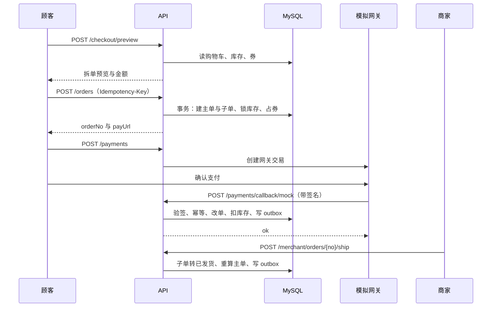
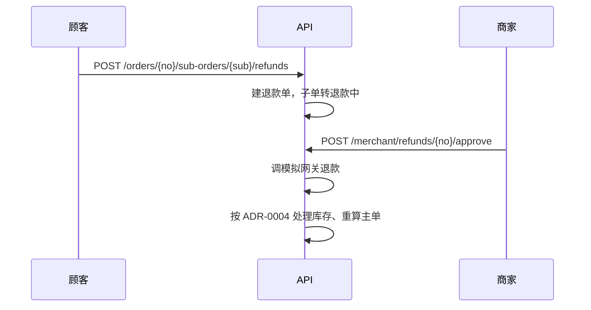

# API 契约（G1）

三种调用方：顾客前台、商家后台、平台后台。三套界面共用一套 API，按角色与数据范围鉴权。

## 通用约定

| 项 | 约定 |
|---|---|
| 基址 | `/api/v1` |
| 格式 | JSON；文件上传用 `multipart/form-data` |
| 认证 | 服务端会话（Spring Session + Redis），`Cookie: KD_SESSION` |
| CSRF | 非 `GET` 请求必须带 `X-XSRF-TOKEN`，值取自 `GET /auth/csrf` |
| 金额 | 整数分，字段以 `_cent` 结尾 |
| 时间 | ISO-8601 带偏移，如 `2026-10-27T14:05:00+08:00` |
| 分页 | `page` 从 1 开始、`size` 默认 20（上限 100）、`sort` 如 `createdAt,desc` |
| 幂等 | 创建订单、发起支付带 `Idempotency-Key`，同键 10 分钟内只执行一次 |
| 错误 | 见 [error-codes.md](error-codes.md)，HTTP 状态码与 `code` 并存 |

分页响应：

```json
{ "code": 0, "message": "ok", "traceId": "9f2c1a",
  "data": { "items": [], "total": 128, "page": 1, "size": 20 } }
```

权限标记：`公开` / `登录` / `商家` / `客服` / `运营` / `管理员`。标 `本店` 的接口只允许访问当前商家自己的资源。

## 1. 认证

| 方法 | 路径 | 说明 | 权限 |
|---|---|---|---|
| GET | `/auth/csrf` | 取 CSRF token | 公开 |
| POST | `/auth/register` | 注册（邮箱、密码、昵称） | 公开 |
| POST | `/auth/login` | 登录，返回用户与角色 | 公开 |
| POST | `/auth/logout` | 登出，销毁会话 | 登录 |
| GET | `/auth/me` | 当前用户、角色、店铺状态 | 登录 |
| POST | `/auth/verify-email` | 校验令牌，置邮箱已验证 | 公开 |
| POST | `/auth/resend-verification` | 重发验证邮件 | 公开 |
| POST | `/auth/forgot-password` | 发送重置邮件 | 公开 |
| POST | `/auth/reset-password` | 用令牌重置密码 | 公开 |
| PUT | `/auth/password` | 修改密码（需旧密码） | 登录 |

## 2. 个人中心

| 方法 | 路径 | 说明 | 权限 |
|---|---|---|---|
| GET / PUT | `/me` | 查看 / 修改资料 | 登录 |
| GET | `/me/addresses` | 地址列表 | 登录 |
| POST | `/me/addresses` | 新增地址 | 登录 |
| PUT | `/me/addresses/{id}` | 修改地址 | 登录 |
| DELETE | `/me/addresses/{id}` | 删除地址（软删） | 登录 |
| PUT | `/me/addresses/{id}/default` | 设为默认 | 登录 |
| GET | `/me/coupons` | 我的优惠券 | 登录 |
| POST | `/me/coupons/{couponId}/claim` | 领取优惠券 | 登录 |
| GET | `/me/favorites` | 收藏列表 | 登录 |
| POST | `/me/favorites` | 收藏商品 | 登录 |
| DELETE | `/me/favorites/{productId}` | 取消收藏 | 登录 |

## 3. 商品与店铺

| 方法 | 路径 | 说明 | 权限 |
|---|---|---|---|
| GET | `/categories` | 类目树（两级） | 公开 |
| GET | `/products` | 商品列表：`keyword`、`categoryId`、`minPrice`、`maxPrice`、`sort` | 公开 |
| GET | `/products/{id}` | 商品详情（SKU、库存、店铺信息） | 公开 |
| GET | `/products/{id}/reviews` | 商品评价（分页） | 公开 |
| GET | `/shops/{merchantId}` | 店铺信息 | 公开 |
| GET | `/shops/{merchantId}/products` | 店内商品 | 公开 |

## 4. 购物车

| 方法 | 路径 | 说明 | 权限 |
|---|---|---|---|
| GET | `/cart` | 购物车（按商家分组） | 登录 |
| POST | `/cart/items` | 加购 `{skuId, quantity}` | 登录 |
| PUT | `/cart/items/{id}` | 改数量或勾选 `{quantity?, selected?}` | 登录 |
| DELETE | `/cart/items/{id}` | 删除 | 登录 |
| POST | `/cart/merge` | 合并本地购物车 `{items:[{skuId,quantity}]}` | 登录 |

## 5. 结算与订单

| 方法 | 路径 | 说明 | 权限 |
|---|---|---|---|
| POST | `/checkout/preview` | 结算预览：金额明细与拆单结果 | 登录 |
| POST | `/orders` | 创建订单（幂等） | 登录 |
| GET | `/orders` | 主单列表（`status` 筛选） | 登录 |
| GET | `/orders/{orderNo}` | 主单详情（含子单） | 登录 |
| POST | `/orders/{orderNo}/cancel` | 取消未支付订单 | 登录 |
| POST | `/orders/{orderNo}/sub-orders/{subOrderNo}/confirm` | 确认收货 | 登录 |
| POST | `/orders/{orderNo}/sub-orders/{subOrderNo}/refunds` | 申请退款 `{reason}` | 登录 |

结算预览响应：

```json
{ "data": {
    "subOrders": [
      { "merchantId": 3, "shopName": "山野杂货", "goodsAmount": 12800,
        "shippingFee": 0, "discount": 1280, "payAmount": 11520 }
    ],
    "summary": { "goodsAmount": 12800, "discount": 1280, "shippingFee": 0, "payAmount": 11520 },
    "coupons": { "usable": [], "unusable": [] } } }
```

拆单与金额计算全部在服务端完成，前端只展示。优惠按子单商品金额比例分摊，尾差归金额最大的子单。

创建订单：

```http
POST /api/v1/orders
Idempotency-Key: 7d1b0c9e-2f4a-4b8c-9d10-6e5f4a3b2c1d

{ "addressId": 12, "couponId": 5,
  "items": [{ "skuId": 101, "quantity": 2 }],
  "remark": "周末送" }
```

```json
{ "data": { "orderNo": "KD202610270001", "payAmount": 11520,
  "paymentNo": "PAY202610270001", "payUrl": "/mock-pay/PAY202610270001",
  "subOrders": [{ "subOrderNo": "KD202610270001-3", "shopName": "山野杂货", "payAmount": 11520 }] } }
```

## 6. 支付

| 方法 | 路径 | 说明 | 权限 |
|---|---|---|---|
| POST | `/payments` | 创建支付 `{orderNo}`，返回网关地址 | 登录 |
| GET | `/payments/{paymentNo}` | 支付状态（前端轮询） | 登录 |
| POST | `/payments/callback/mock` | 模拟网关回调（验签） | 网关 |

回调请求（网关到平台）：

```json
{ "outTradeNo": "PAY202610270001", "amount": 11520, "status": "SUCCESS",
  "timestamp": 1793529600000, "nonce": "a1b2c3", "sign": "hmac-sha256-hex" }
```

平台响应固定为 `{"code":0,"message":"ok"}`；重复回调返回同样结果。

## 7. 商家端

| 方法 | 路径 | 说明 | 权限 |
|---|---|---|---|
| POST | `/merchant/applications` | 提交入驻申请 | 登录 |
| GET | `/merchant/applications/me` | 我的申请与状态 | 登录 |
| PUT | `/merchant/applications/me` | 修改并重新提交（被拒后） | 登录 |
| GET / PUT | `/merchant/profile` | 店铺资料 | 商家·本店 |
| GET | `/merchant/dashboard` | 店铺看板 | 商家·本店 |
| GET | `/merchant/products` | 本店商品 | 商家·本店 |
| POST | `/merchant/products` | 新建商品（含 SKU 数组） | 商家·本店 |
| PUT | `/merchant/products/{id}` | 编辑商品 | 商家·本店 |
| PUT | `/merchant/products/{id}/status` | 上下架 `{status}` | 商家·本店 |
| DELETE | `/merchant/products/{id}` | 删除（软删） | 商家·本店 |
| GET | `/merchant/orders` | 子单列表 | 商家·本店 |
| GET | `/merchant/orders/{subOrderNo}` | 子单详情 | 商家·本店 |
| POST | `/merchant/orders/{subOrderNo}/ship` | 发货 `{carrier, trackingNo}` | 商家·本店 |
| GET | `/merchant/refunds` | 退款列表 | 商家·本店 |
| POST | `/merchant/refunds/{refundNo}/approve` | 同意退款 | 商家·本店 |
| POST | `/merchant/refunds/{refundNo}/reject` | 驳回 `{reason}` | 商家·本店 |
| GET | `/merchant/settlements` | 结算单列表 | 商家·本店 |
| GET | `/merchant/settlements/{settlementNo}` | 结算单明细 | 商家·本店 |
| POST | `/files` | 图片上传（商品图、资质图） | 登录 |

## 8. 平台端

| 方法 | 路径 | 说明 | 权限 |
|---|---|---|---|
| GET | `/admin/merchants` | 商家列表（按状态筛选） | 运营 |
| GET | `/admin/merchants/{id}` | 商家详情与审核记录 | 运营 |
| POST | `/admin/merchants/{id}/approve` | 审核通过 | 运营 |
| POST | `/admin/merchants/{id}/reject` | 驳回 `{reason}` | 运营 |
| POST | `/admin/merchants/{id}/suspend` | 封禁 `{reason}` | 运营 |
| POST | `/admin/merchants/{id}/resume` | 解封 | 运营 |
| PUT | `/admin/merchants/{id}/commission` | 设置佣金费率 | 管理员 |
| GET | `/admin/orders` | 全平台主单检索 | 客服 |
| GET | `/admin/orders/{orderNo}` | 主单详情（含子单） | 客服 |
| GET | `/admin/refunds` | 全平台退款单 | 客服 |
| POST | `/admin/refunds/{refundNo}/approve` | 强制同意退款 | 客服 |
| POST | `/admin/refunds/{refundNo}/reject` | 驳回退款 | 客服 |
| GET | `/admin/customers` | 顾客列表（脱敏） | 客服只读 / 运营可改 |
| POST | `/admin/customers/{id}/disable` | 禁用账号 | 运营 |
| POST | `/admin/customers/{id}/enable` | 启用账号 | 运营 |
| GET | `/admin/products` | 全平台商品 | 运营 |
| PUT | `/admin/products/{id}/force-offline` | 强制下架 `{reason}` | 运营 |
| GET | `/admin/categories` | 类目树 | 运营 |
| POST | `/admin/categories` | 新增类目 | 运营 |
| PUT | `/admin/categories/{id}` | 修改类目 | 运营 |
| DELETE | `/admin/categories/{id}` | 删除类目（有商品则拒绝） | 运营 |
| GET / POST | `/admin/coupons` | 平台券列表 / 新建 | 运营 |
| PUT | `/admin/coupons/{id}` | 修改或停用 | 运营 |
| GET | `/admin/reviews` | 评价列表 | 运营 |
| PUT | `/admin/reviews/{id}/status` | 隐藏或恢复 | 运营 |
| POST | `/admin/settlements/generate` | 生成结算单 `{periodStart, periodEnd}` | 运营 |
| GET | `/admin/settlements` | 结算单列表 | 运营 |
| POST | `/admin/settlements/{settlementNo}/settle` | 确认打款（模拟） | 运营 |
| GET | `/admin/dashboard` | 平台看板 | 客服只读 / 运营 |
| GET | `/admin/audit-logs` | 审计日志 | 管理员 |
| POST | `/admin/users/{id}/roles` | 分配角色 | 管理员 |

## 9. 系统

| 方法 | 路径 | 说明 | 权限 |
|---|---|---|---|
| GET | `/health` | 存活与依赖检查（DB / Redis / MinIO） | 公开 |
| GET | `/meta` | 前端启动配置：货币、时区、运费规则、当前角色 | 公开 |

## 10. 关键流程

### 下单 → 支付 → 发货



### 退款



## 11. 契约维护

- 本文件是前后端的唯一契约来源：先改这里，再改代码
- 前端用 MSW 按本文件生成 mock，后端未就绪也能并行开发
- 每个端点在 `frontend/src/api` 下有同名 TS 类型，字段名与本文档一致
- 破坏性变更在 PR 描述里标注，并同步更新本文档
