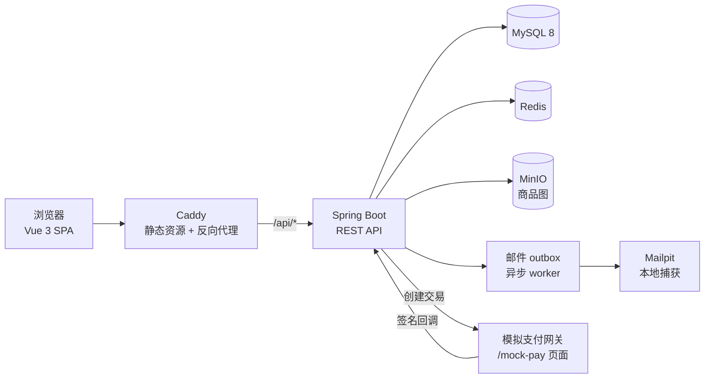
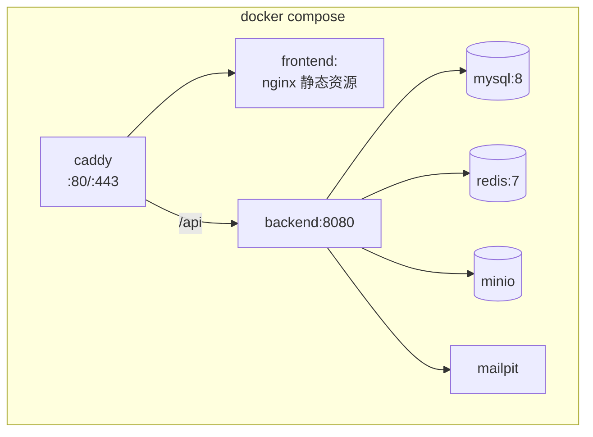

# 架构总览（G1）

## 1. 系统全景



三套界面共用一次构建，按路由前缀分包；后端一个进程，按角色与数据范围鉴权。

## 2. 仓库结构

```
kdshop/
├── backend/                 Spring Boot 3 + MyBatis-Plus
│   ├── src/main/java/com/kdshop/
│   ├── src/main/resources/
│   │   ├── db/migration/   Flyway 脚本
│   │   ├── mail-templates/ Thymeleaf 邮件模板
│   │   └── application*.yml
│   └── pom.xml
├── frontend/                Vue 3 + TS + Vite
│   ├── src/{api,components,layouts,views,stores,router,utils}
│   └── package.json
├── infra/                   docker-compose、Caddyfile、种子数据
├── docs/                    需求、设计、ADR、API
└── .github/workflows/       CI
```

## 3. 后端分层

按领域分包，每个包内保持「接口层 → 应用层 → 领域层 → 持久层」四层：

| 层 | 职责 | 禁止 |
|---|---|---|
| `controller` | 参数校验、DTO 转换、调用应用服务 | 写业务分支、直接调 mapper |
| `application` | 用例编排、事务边界、跨模块协调 | 拼 SQL、写 HTTP 细节 |
| `domain` | 实体、值对象、状态机、领域规则 | 依赖 Spring 上下文 |
| `mapper` | MyBatis-Plus 映射与查询 | 跨模块直接引用 |

```
com.kdshop
├── common/        统一响应、错误码、异常、分页、trace
├── config/        Security、MyBatis、Redis、Jackson、OpenAPI
├── auth/          注册登录、会话、令牌
├── catalog/       类目、商品、SKU、库存
├── cart/          购物车与合并
├── order/         结算、主单、子单、状态聚合
├── payment/       支付单、模拟网关、回调验签
├── refund/        退款申请与审核
├── settlement/    结算单生成与对账
├── merchant/      入驻、店铺、商家后台接口
├── admin/         平台后台接口
├── marketing/     优惠券、收藏、评价
└── infra/         邮件 outbox、对象存储、定时任务
```

跨模块只允许调用对方的 `application` 接口，不允许 import 对方的 `mapper`。

## 4. 前端结构

```
frontend/src
├── api/            按域拆分的请求模块 + 生成的 TS 类型
├── layouts/        shop / merchant / admin 三套布局
├── views/
│   ├── shop/       首页、列表、详情、购物车、结算、订单、账户
│   ├── merchant/   看板、商品、子单、退款、结算
│   └── admin/      看板、商家、商品、订单、结算、角色、审计
├── components/     通用表格、分页、金额展示、状态标签
├── stores/         auth（用户与角色）、cart（本地购物车）
├── router/         三棵路由树 + 全局守卫
└── utils/          请求封装、金额格式化、日期
```

- 守卫按 `meta.roles` 控制入口，但**权限判断以接口 403 为准**
- 金额一律按「分」传输，展示层统一格式化，避免浮点
- 列表页筛选条件写进 URL query，方便回跳与分享

## 5. 部署拓扑



- 本地：`docker compose up -d` 起基础设施，前后端用热更新命令跑
- 线上：同一份 compose 加 Caddy 与正式配置，用户在自己的阿里云机器执行
- 后端只暴露 8080 给内网，公网入口只有 Caddy

## 6. 横切关注点

| 关注点 | 做法 |
|---|---|
| 鉴权 | Spring Security 会话 + `@PreAuthorize`；商家身份由服务端解析，不信前端 |
| 数据隔离 | Service 层统一 `assertOwnership`，越权返回 403 |
| 异常 | `@RestControllerAdvice` 统一转 `BusinessException(code)` |
| 链路追踪 | `TraceIdFilter` 生成 traceId 写入 MDC 与响应体 |
| 审计 | `@Audited(action, targetType)` 切面写 `audit_logs` |
| 幂等 | `Idempotency-Key` + Redis SETNX（10 分钟），重复请求返回首次结果引用 |
| 缓存 | 商品详情 TTL 60s，改价/上下架主动删除；类目树 TTL 300s |
| 事务 | 一个应用服务方法一个事务；邮件只写 outbox，不阻塞主流程 |

## 7. 一致性与异步

- **强一致**：订单、支付、库存、结算 —— 全部在数据库事务内完成
- **最终一致**：邮件、看板统计、结算生成 —— outbox / 定时任务
- **定时任务**：单实例部署，直接用 `@Scheduled`；订单超时取消、自动确认收货、结算生成、结算对账
- 所有定时任务必须**可重跑**：以状态条件更新驱动，重复执行不产生副作用

## 8. 测试分层

| 层 | 范围 | 工具 | 何时跑 |
|---|---|---|---|
| 单元 | 状态机、金额计算、拆单与分摊 | JUnit 5 + AssertJ | 每次提交 |
| 集成 | 接口 + 数据库 + Redis | Spring Boot Test + Testcontainers | 每次 PR |
| 契约 | 响应结构与错误码 | OpenAPI 快照比对 | 每次 PR |
| 端到端 | 下单到发货主线、商家入驻到结算 | Playwright | 每次合并 main |

## 9. 配置与环境

| 环境 | 配置文件 | 依赖 |
|---|---|---|
| local | `application-local.yml` | compose 基础设施，Mailpit 捕获 |
| test | `application-test.yml` | Testcontainers |
| prod | `application-prod.yml` | 环境变量注入，`OutboxOnlySender` 不真发邮件 |

- 所有密钥、连接串来自环境变量，仓库只有 `.env.example`
- 启动时校验必填变量，缺失即快速失败并打印缺失项

## 10. 非功能指标（G1 定值）

| 指标 | 目标 | 怎么验 |
|---|---|---|
| 商品列表/详情接口 p95 | < 300ms（本机） | 压测脚本，100 并发 |
| 下单接口 p95 | < 500ms | 同上，含库存锁与拆单 |
| 首页首屏 | < 2s（本地千兆） | Lighthouse |
| 下单并发 | 100 并发无 5xx、无超卖 | 压测 + 库存对账 SQL |
| 可用性 | 单机演示级 | 不做 SLA 承诺 |

## 11. 边界与取舍

- 单实例部署：不做会话共享之外的集群能力，定时任务不加分布式锁
- 不引入消息队列：异步场景只有邮件与结算，定时任务足够
- 不做多租户隔离：商家隔离靠 `merchant_id` 过滤，不拆库
- 图片走 MinIO 单桶 + 前缀分区（商品图 `product/{id}/`，资质图 `merchant/{id}/`）

这些边界在量级变化时需要重审，判断依据写在各条 ADR 的「何时重审」里。
