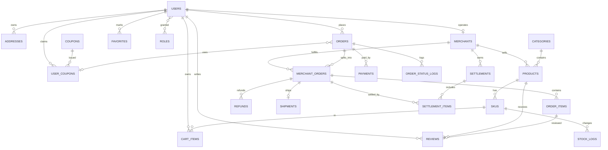

# 数据模型（G1）

平台模式：多商家入驻，顾客一次结算按商家拆成子单，平台代收货款并按子单结算给商家。

## 设计约定

- 表名单数、snake_case；主键 `bigint unsigned auto_increment`，业务单号另建唯一索引
- 金额一律 `int` 存「分」；时间一律 `datetime(3)` 存 UTC，展示层按 Asia/Shanghai 转换
- 通用审计列：`created_at`、`updated_at`；需要软删的表加 `deleted_at`
- **快照原则**：订单行保存商品名、规格、单价与商家名快照，商品改价不回溯历史订单
- **逻辑外键**：不建物理外键，靠应用层校验 + 唯一索引保证一致性（ADR-0003）
- 库存并发用条件更新：`UPDATE sku SET locked_stock = locked_stock + ? WHERE id = ? AND stock - locked_stock >= ?`

## ER 图

## 表清单

### 账号与商家域

| 表 | 关键字段 | 约束/索引 |
|---|---|---|
| `users` | id, email, password_hash, nickname, phone, status(ACTIVE/DISABLED), email_verified_at, last_login_at | `uk_users_email` |
| `roles` | id, code(GUEST/CUSTOMER/MERCHANT/SUPPORT/OPERATOR/ADMIN), name | `uk_roles_code` |
| `user_roles` | user_id, role_id | `uk_user_roles`(user_id, role_id) |
| `addresses` | id, user_id, receiver, phone, province, city, district, detail, is_default, deleted_at | `idx_addresses_user` |
| `auth_tokens` | id, user_id, type(VERIFY/RESET), token_hash, expires_at, used_at | `uk_auth_tokens_hash` |
| `merchants` | id, user_id, shop_name, logo, description, contact_name, contact_phone, license_image, status(PENDING/ACTIVE/REJECTED/SUSPENDED), reject_reason, commission_rate(bp), approved_at, approved_by | `uk_merchants_user`、`uk_merchants_shop` |

> 入驻即「一条 merchants 记录 + 状态流转」，不另建申请表；被拒后可改资料重新提交，复用同一条记录。

### 商品域

| 表 | 关键字段 | 约束/索引 |
|---|---|---|
| `categories` | id, parent_id, name, sort, status | `idx_categories_parent`（平台统一维护） |
| `products` | id, merchant_id, category_id, name, subtitle, description, main_image, images_json, status(ON/OFF), offline_reason, sales_count, deleted_at | `idx_products_merchant`、`idx_products_category_status`、`ft_products_name_desc`(FULLTEXT) |
| `skus` | id, product_id, spec_json, price_cent, original_price_cent, stock, locked_stock, status | `uk_skus_product_spec`、`idx_skus_product` |
| `stock_logs` | id, sku_id, change_qty, before_qty, after_qty, type(LOCK/UNLOCK/DEDUCT/RELEASE/ADJUST), ref_no, operator_id | `idx_stock_logs_sku` |

### 交易域

| 表 | 关键字段 | 约束/索引 |
|---|---|---|
| `cart_items` | id, user_id, sku_id, quantity | `uk_cart_user_sku` |
| `orders` | id, order_no, user_id, status, merchant_count, goods_amount_cent, discount_cent, shipping_fee_cent, pay_amount_cent, address_json, coupon_id, remark, paid_at, completed_at, cancelled_at, cancel_reason, version | `uk_orders_no`、`idx_orders_user_status`、`idx_orders_status_created` |
| `merchant_orders` | id, sub_order_no, order_id, merchant_id, status, goods_amount_cent, discount_cent, shipping_fee_cent, pay_amount_cent, refunded_amount_cent, shipped_at, completed_at, settled | `uk_mo_no`、`idx_mo_merchant_status`、`idx_mo_order` |
| `order_items` | id, merchant_order_id, order_id, merchant_id, sku_id, product_id, product_name, shop_name, sku_spec, unit_price_cent, quantity, subtotal_cent | `idx_oi_mo`、`idx_oi_product` |
| `payments` | id, payment_no, order_id, channel(MOCK), amount_cent, status, out_trade_no, paid_at, callback_at, callback_raw | `uk_payments_out_trade_no`、`uk_payments_no` |
| `refunds` | id, refund_no, merchant_order_id, order_id, merchant_id, amount_cent, reason, status, reject_reason, operator_type(MERCHANT/SUPPORT), operator_id, finished_at | `uk_refunds_no`、`idx_refunds_merchant` |
| `shipments` | id, merchant_order_id, carrier, tracking_no, operator_id, shipped_at | `uk_shipments_mo` |
| `order_status_logs` | id, scope(ORDER/MERCHANT_ORDER), order_id, merchant_order_id, from_status, to_status, operator_type(USER/MERCHANT/ADMIN/SYSTEM), operator_id, reason | `idx_osl_order`、`idx_osl_mo` |

### 结算域

| 表 | 关键字段 | 约束/索引 |
|---|---|---|
| `settlements` | id, settlement_no, merchant_id, period_start, period_end, gross_amount_cent, commission_cent, refund_cent, net_amount_cent, status(PENDING/SETTLED), settled_at | `uk_settlements_no`、`uk_settlements_merchant_period` |
| `settlement_items` | id, settlement_id, merchant_order_id, gross_amount_cent, commission_cent, net_amount_cent | `uk_settlement_items_mo` |

### 营销与支撑域

| 表 | 关键字段 | 约束/索引 |
|---|---|---|
| `coupons` | id, code, name, type(FIXED/THRESHOLD), value_cent, min_amount_cent, total, used_count, scope(PLATFORM)，starts_at, ends_at, status | `uk_coupons_code`（首版仅平台券） |
| `user_coupons` | id, user_id, coupon_id, status(UNUSED/USED/EXPIRED), order_id, used_at | `uk_user_coupons`(user_id, coupon_id) |
| `favorites` | id, user_id, product_id | `uk_favorites`(user_id, product_id) |
| `reviews` | id, order_item_id, user_id, product_id, merchant_id, rating, content, status(VISIBLE/HIDDEN) | `uk_reviews_item` |
| `email_outbox` | id, to_email, template, biz_key, payload_json, status(PENDING/SENT/FAILED), error, sent_at | `uk_outbox_biz_key` |
| `audit_logs` | id, actor_type, actor_id, action, target_type, target_id, before_json, after_json, ip | `idx_audit_actor`、`idx_audit_target` |

## 关键约束与不变量

1. `orders.pay_amount_cent = goods_amount_cent - discount_cent + shipping_fee_cent`，且 ≥ 0
2. `Σ merchant_orders.pay_amount_cent = orders.pay_amount_cent`（拆单后金额必须对齐，尾差归最后一个子单）
3. `Σ order_items.subtotal_cent = merchant_orders.goods_amount_cent`
4. `sku.stock >= 0`、`sku.locked_stock >= 0`
5. 优惠券折扣按各子单商品金额比例分摊，尾差给金额最大的子单
6. 一个子单同时最多一条进行中的退款；重复申请返回 409
7. `settlement_items` 中同一子单只能出现一次（唯一索引兜底），防止重复结算
8. 商家被 `SUSPENDED` 后：商品全部下架、未发货子单仍可发货（避免伤到已付款顾客）、不能上新

## 索引与容量

100～1000 SKU 量级：商品列表走 `(category_id, status)`；商家后台走 `(merchant_id, status)`；搜索用 MySQL FULLTEXT（ngram 分词器）。商品量超过 1 万再考虑搜索引擎。

## V3/V4 扩展（2026-10-28）

定位于手作市集后新增的结构，见 [ADR-0009](adr/0009-数据模型特色化.md)。两版迁移均为增量变更，已在空库按 V1→V4 验证。

### V3 定制交易与售后

| 表 | 关键字段 |
|---|---|
| `products`（加列） | `sale_mode`(IN_STOCK/PREORDER/CUSTOM)、`lead_days`、`deposit_rate`(基点) |
| `orders`（加列） | `order_type`、`deposit_cent`、`balance_cent`、`promised_ship_at`、`penalty_cent` |
| `payments`（加列） | `purpose`(FULL/DEPOSIT/BALANCE) |
| `after_sales` | as_no、merchant_order_id、type(REFUND_ONLY/RETURN_REFUND)、reason_code、evidence_json、status、refund_amount_cent、return_*、received_at、inspect_result(GOOD/DEFECTIVE)、responsibility(MERCHANT/LOGISTICS/CUSTOMER) |
| `after_sales_logs` | 售后状态流水 |
| `penalties` | 赔付单：merchant_order_id + days_overdue 唯一，防止重复计赔 |

### V4 作品档案与多维标签

| 表 | 关键字段 |
|---|---|
| `products`（加列） | `story`、`edition_size`、`edition_no`、`is_unique`、`flaw_note`、`requires_flaw_ack` |
| `orders`（加列） | `is_gift`、`gift_message`、`gift_wrap` |
| `tags` | dimension(CRAFT/MATERIAL/OCCASION) + slug 唯一 |
| `product_tags` | 商品与标签多对多，按 tag_id 反查 |
| `product_options` | 定制项定义：TEXT/ENUM、必填、字数上限、加价 |
| `order_item_options` | 下单时的定制项快照，参与订单行金额 |

### 新增不变量

1. 限量商品 `edition_no <= edition_size`；孤品 `is_unique = 1` 时库存上限为 1
2. `Σ order_item_options.price_delta_cent` 计入该订单行 `subtotal_cent`
3. 同一子单同一逾期天数只有一条赔付记录
4. 售后单在同一子单上同时只能有一条未关闭记录
