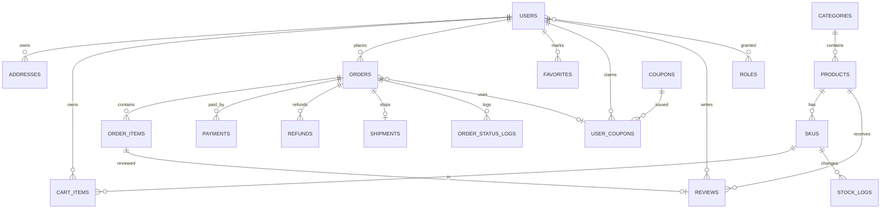

# 数据模型（G1）

## 设计约定

- 表名单数、snake_case；主键 `bigint unsigned auto_increment`，业务单号另建唯一索引
- 金额一律 `int` 存「分」；时间一律 `datetime(3)` 存 UTC，展示层按 Asia/Shanghai 转换
- 通用审计列：`created_at`、`updated_at`；需要软删的表加 `deleted_at`
- **快照原则**：订单行保存商品名、规格、单价快照，商品改价不回溯历史订单
- **逻辑外键**：不建物理外键，靠应用层校验 + 唯一索引保证一致性（理由见 ADR-0003）
- 库存并发用条件更新：`UPDATE sku SET stock = stock - ? WHERE id = ? AND stock >= ?`

## ER 图

## 表清单

### 账号域

| 表 | 关键字段 | 约束/索引 |
|---|---|---|
| `users` | id, email, password_hash, nickname, phone, status(ACTIVE/DISABLED), email_verified_at, last_login_at | `uk_users_email` |
| `roles` | id, code(ADMIN/OPERATOR/SUPPORT/CUSTOMER), name | `uk_roles_code` |
| `user_roles` | user_id, role_id | `uk_user_roles`(user_id, role_id) |
| `addresses` | id, user_id, receiver, phone, province, city, district, detail, is_default, deleted_at | `idx_addresses_user` |
| `auth_tokens` | id, user_id, type(VERIFY/RESET), token_hash, expires_at, used_at | `uk_auth_tokens_hash` |

### 商品域

| 表 | 关键字段 | 约束/索引 |
|---|---|---|
| `categories` | id, parent_id, name, sort, status | `idx_categories_parent` |
| `products` | id, category_id, name, subtitle, description, main_image, images_json, status(ON/OFF), sales_count, deleted_at | `idx_products_category_status`、`ft_products_name_desc`(FULLTEXT) |
| `skus` | id, product_id, spec_json, price_cent, original_price_cent, stock, locked_stock, status | `uk_skus_product_spec`、`idx_skus_product` |
| `stock_logs` | id, sku_id, change_qty, before_qty, after_qty, type(LOCK/UNLOCK/DEDUCT/ADJUST), ref_no, operator_id | `idx_stock_logs_sku` |

### 交易域

| 表 | 关键字段 | 约束/索引 |
|---|---|---|
| `cart_items` | id, user_id, sku_id, quantity | `uk_cart_user_sku` |
| `orders` | id, order_no, user_id, status, goods_amount_cent, discount_cent, shipping_fee_cent, pay_amount_cent, address_json, coupon_id, remark, paid_at, shipped_at, completed_at, cancelled_at, cancel_reason, version | `uk_orders_no`、`idx_orders_user_status` |
| `order_items` | id, order_id, sku_id, product_id, product_name, sku_spec, unit_price_cent, quantity, subtotal_cent | `idx_order_items_order` |
| `payments` | id, payment_no, order_id, channel(MOCK), amount_cent, status, out_trade_no, paid_at, callback_at, callback_raw | `uk_payments_out_trade_no`、`uk_payments_no` |
| `refunds` | id, refund_no, order_id, amount_cent, reason, status, reject_reason, operator_id, finished_at | `uk_refunds_no` |
| `shipments` | id, order_id, carrier, tracking_no, operator_id, shipped_at | `uk_shipments_order` |
| `order_status_logs` | id, order_id, from_status, to_status, operator_type(USER/ADMIN/SYSTEM), operator_id, reason | `idx_osl_order` |

### 营销域

| 表 | 关键字段 | 约束/索引 |
|---|---|---|
| `coupons` | id, code, name, type(FIXED/THRESHOLD), value_cent, min_amount_cent, total, used_count, starts_at, ends_at, status | `uk_coupons_code` |
| `user_coupons` | id, user_id, coupon_id, status(UNUSED/USED/EXPIRED), order_id, used_at | `uk_user_coupons`(user_id, coupon_id) |
| `favorites` | id, user_id, product_id | `uk_favorites`(user_id, product_id) |
| `reviews` | id, order_item_id, user_id, product_id, rating, content, status(VISIBLE/HIDDEN) | `uk_reviews_item` |

### 支撑域

| 表 | 关键字段 | 约束/索引 |
|---|---|---|
| `email_outbox` | id, to_email, template, payload_json, status(PENDING/SENT/FAILED), error, sent_at | `idx_outbox_status` |
| `audit_logs` | id, actor_type, actor_id, action, target_type, target_id, before_json, after_json, ip | `idx_audit_actor`、`idx_audit_target` |

## 关键约束与不变量

1. `orders.pay_amount_cent = goods_amount_cent - discount_cent + shipping_fee_cent`，且 ≥ 0
2. `sku.stock >= 0`、`sku.locked_stock >= 0`，两者之和不超过入库总量
3. 订单行金额之和 = `orders.goods_amount_cent`
4. `payments.amount_cent` = 对应订单的 `pay_amount_cent`，不符则回调拒绝
5. 一个订单同时最多一条 `PENDING/SUCCESS` 支付记录（部分退款的后续版本再放宽）
6. 已使用的优惠券不可再用；退款后券是否返还由 ADR-0004 决定

## 索引与容量

100 SKU 量级下，列表查询走 `(category_id, status)` 覆盖索引即可；搜索用 MySQL FULLTEXT（ngram 分词器）而不引入 ES。商品总量上限按 1 万设计，超出再考虑搜索引擎。
