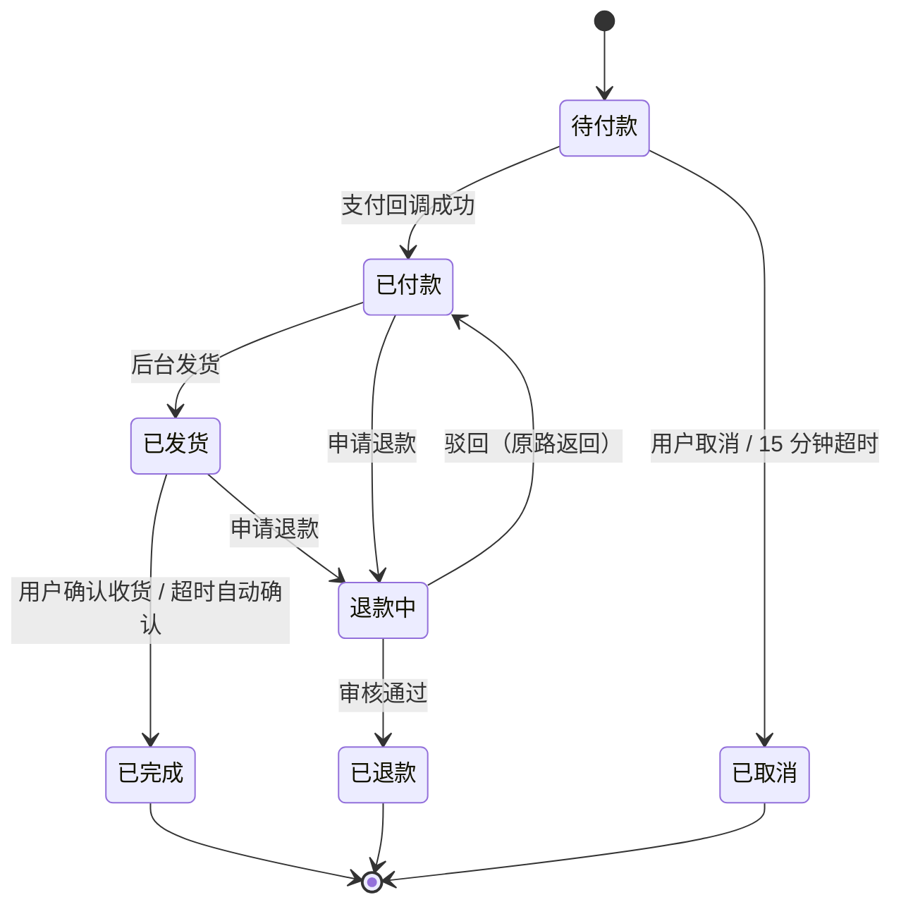
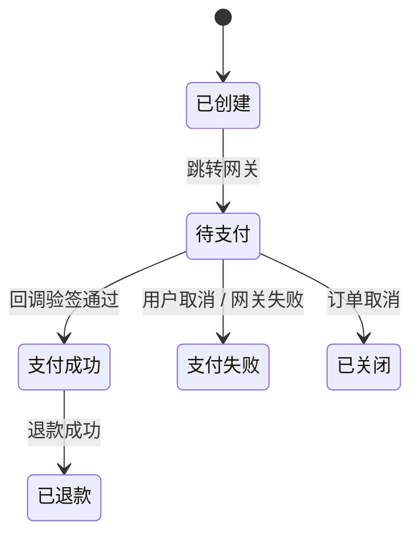
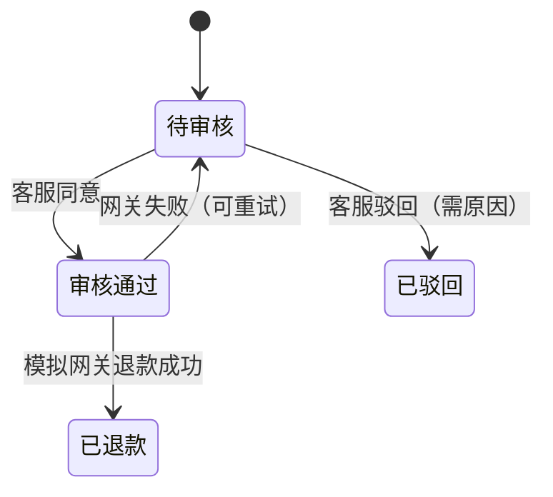

# 订单 / 支付 / 退款状态机（G1）

状态字段是交易系统的真相来源。任何状态变更都必须：校验来源状态、写 `order_status_logs`、在同一事务内完成副作用（库存、券、邮件 outbox）。

## 订单



| 变更 | 触发者 | 前置条件 | 副作用 |
|---|---|---|---|
| 待付款 → 已付款 | 系统（回调） | 验签通过、金额一致、支付单未处理过 | 扣减库存（lock→deduct）、置 `paid_at`、发支付成功邮件 |
| 待付款 → 已取消 | 用户 / 定时任务 | 仅「待付款」 | 释放锁定库存、优惠券退回可用 |
| 已付款 → 已发货 | 运营/管理员 | 已付款且无进行中的退款 | 写 `shipments`、置 `shipped_at`、发发货邮件 |
| 已发货 → 已完成 | 用户 / 定时任务 | 已发货 | 置 `completed_at` |
| 已付款/已发货 → 退款中 | 顾客 | 无进行中的退款 | 生成 `refunds` 记录 |
| 退款中 → 已退款 | 客服/运营 | 退款单审核通过 | 调模拟网关退款、库存回补策略见 ADR-0004、发邮件 |
| 退款中 → 已付款 | 客服/运营 | 驳回并填写原因 | 无金额变动 |

**不变量**

- 状态只能沿箭头方向走，跨状态跳转一律拒绝并返回 409
- 每次流转写一条 `order_status_logs`（含操作者与原因）
- 取消与支付同时到达时，以数据库行锁 + 状态条件更新为准，先到者生效

## 支付



**回调处理顺序**（缺一不可）

1. 验签（HMAC-SHA256，密钥来自环境变量）
2. 时间窗校验（`|now - timestamp| < 5min`）
3. 幂等（`out_trade_no` 唯一索引 + 已处理标记）
4. 金额比对（回调金额 = 支付单金额 = 订单应付）
5. 状态机校验（支付单 `PENDING` 才可转 `SUCCESS`）
6. 同一事务内：改支付单、改订单、扣库存、写 outbox

## 退款



首版只支持**整单退款**。退款金额 = 订单实付金额；退款成功后订单转「已退款」，库存是否回补由 ADR-0004 记录。

## 超时取消怎么跑

不用消息队列的延迟消息，用「扫描 + 条件更新」，可解释、可重跑：

```sql
SELECT id FROM orders
WHERE status = 'PENDING_PAYMENT' AND created_at < NOW() - INTERVAL 15 MINUTE
ORDER BY id LIMIT 200;
```

- 每 60 秒跑一次，索引 `idx_orders_status_created`(status, created_at)
- 逐条执行「条件更新 + 释放库存 + 写状态日志」，状态条件保证与用户手动取消不打架
- 任务本身幂等：重复扫描不会重复释放，因为第一次已把状态改掉

选择扫描而非延迟队列的理由：15 分钟误差可接受，链条短、出问题好查；订单量上万后再换 Redis ZSET 或 RocketMQ 延迟消息。

## 与库存的关系

| 时机 | 操作 | 说明 |
|---|---|---|
| 提交订单 | 锁定库存 `locked_stock += n` | 条件更新，失败即返回「库存不足」 |
| 支付成功 | 扣减 `stock -= n`、`locked_stock -= n` | 与订单转已付款同事务 |
| 取消/超时 | 释放 `locked_stock -= n` | 幂等：重复取消不重复释放 |
| 退款成功 | 回补 `stock += n` | 仅未发货订单回补，已发货不回补（ADR-0004） |
