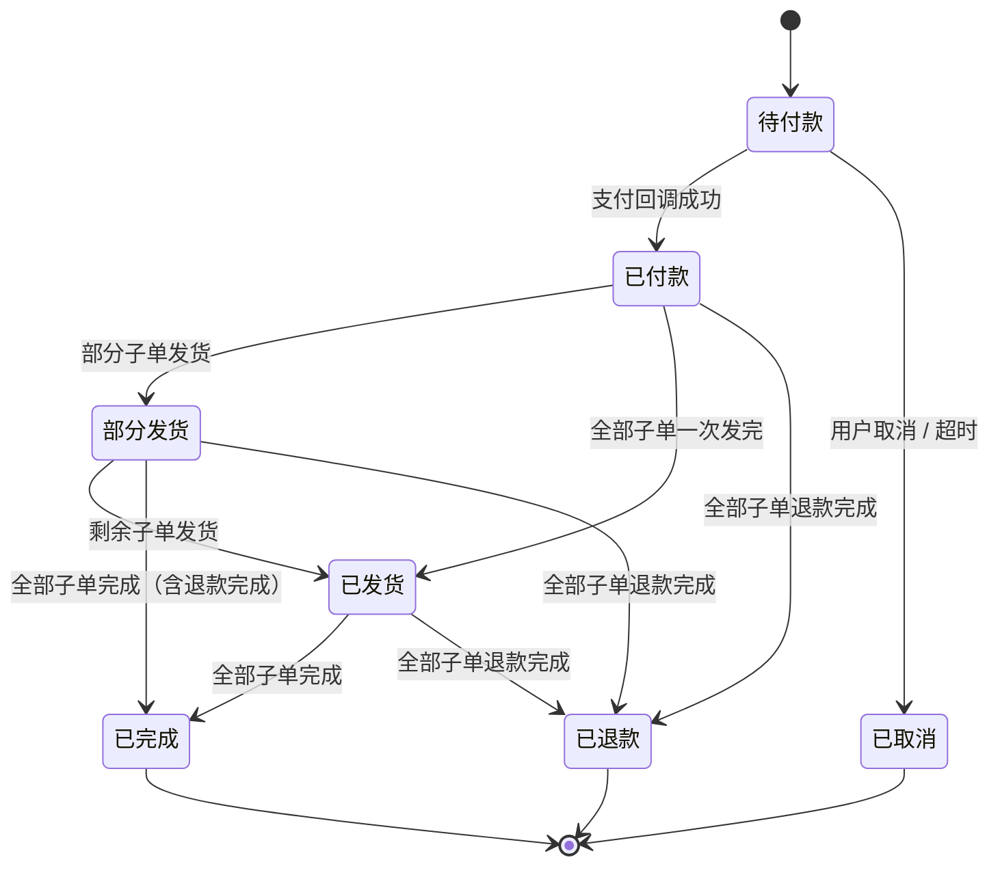
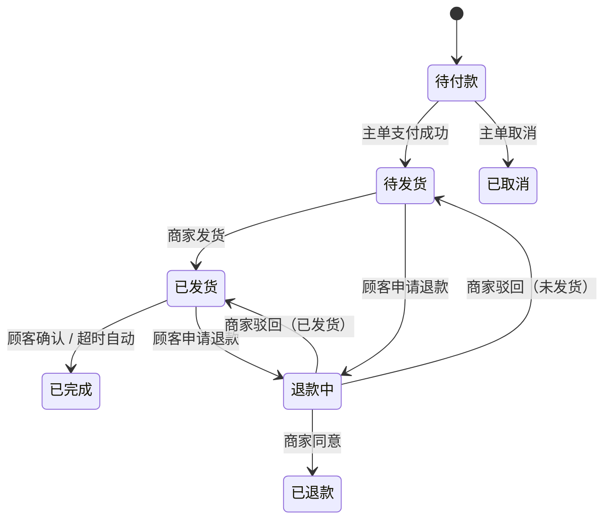
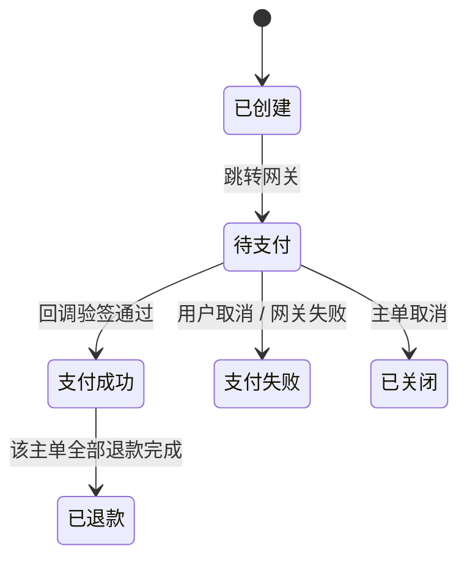
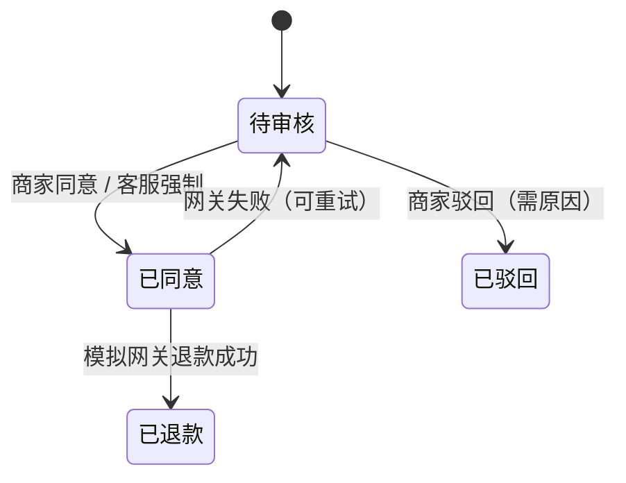
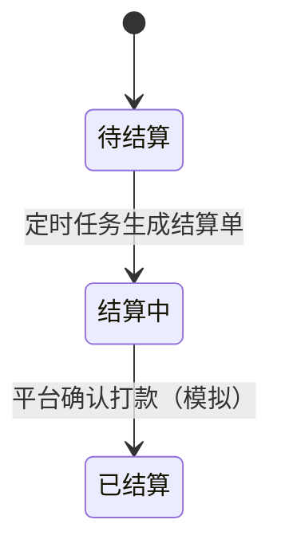

# 订单 / 支付 / 退款 / 结算状态机（G1）

一次结算 = 1 个主单 + N 个商家子单。**状态只存一份**：主单存支付与聚合状态，子单存履约状态；主单状态由子单重算，不手工改。

任何状态变更都必须：校验来源状态、写 `order_status_logs`、在同一事务内完成副作用（库存、券、邮件 outbox、主单重算）。

## 主单（顾客视角）



主单状态是**派生状态**，由子单聚合函数计算，不单独维护流转逻辑：

| 子单集合 | 主单 |
|---|---|
| 全部 PENDING_PAYMENT | 待付款 |
| 全部 PENDING_SHIPMENT | 已付款 |
| 有 SHIPPED，也有 PENDING_SHIPMENT | 部分发货 |
| 全部 SHIPPED | 已发货 |
| 全部 COMPLETED | 已完成 |
| 全部 REFUNDED / CANCELLED | 已退款 / 已取消 |

## 子单（商家视角）



| 变更 | 触发者 | 前置条件 | 副作用 |
|---|---|---|---|
| 待付款 → 待发货 | 系统（支付回调） | 主单支付成功 | 扣减该子单下各 SKU 库存、清锁定 |
| 待付款 → 已取消 | 系统 / 用户 | 主单取消或超时 | 释放锁定库存 |
| 待发货 → 已发货 | 商家 | 有发货权限、未在退款中 | 写 `shipments`、发发货邮件、重算主单 |
| 已发货 → 已完成 | 顾客 / 定时任务 | 已发货 | 置 `completed_at`、重算主单 |
| 待发货/已发货 → 退款中 | 顾客 | 无进行中的退款 | 建 `refunds`，通知商家 |
| 退款中 → 已退款 | 商家 / 平台客服 | 审核通过 | 调模拟网关退款、按 ADR-0004 处理库存、重算主单 |
| 退款中 → 原状态 | 商家 | 驳回且填原因 | 记日志，通知顾客 |

## 支付



支付挂在**主单**上，一笔支付覆盖全部子单。回调处理顺序（缺一不可）：

1. 验签（HMAC-SHA256，密钥来自环境变量）
2. 时间窗校验（`|now - timestamp| < 5min`）
3. 幂等（`out_trade_no` 唯一索引 + 已处理标记）
4. 金额比对（回调金额 = 支付单金额 = 主单应付）
5. 状态校验（支付单 `PENDING` 才可转 `SUCCESS`）
6. 同一事务内：改支付单、改主单、把每个子单转待发货、逐 SKU 扣库存、写 outbox

## 退款（按子单）



- 粒度：**子单整单退**，金额 = 该子单实付（商品 - 分摊优惠 + 运费）
- 审核人：商家；平台客服可强制同意（纠纷介入），需记录原因
- 部分退款、单行退款首版不做

## 结算



可结算条件（三条同时满足）：

1. 子单状态 = `COMPLETED`
2. `completed_at <= now - 售后保护期（默认 7 天）`
3. 该子单未被任何结算单引用（唯一索引兜底）

金额口径：

```
gross   = 子单实付金额（商品金额 - 分摊优惠 + 运费）
commission = round(gross × 商家费率)
net     = gross - commission
```

退款发生在结算前的，直接不计入；退款发生在结算后的，从下一期结算中扣减（`refund_cent` 字段）。

## 与库存的关系

| 时机 | 操作 | 说明 |
|---|---|---|
| 提交订单 | 逐个 SKU 锁定 `locked_stock += n` | 任一 SKU 失败则整单失败并回滚全部锁定 |
| 支付成功 | 逐个子单扣减 `stock -= n`、`locked_stock -= n` | 与主单转已付款同事务 |
| 取消/超时 | 释放 `locked_stock -= n` | 幂等：重复取消不重复释放 |
| 退款成功 | 未发货回补 `stock += n`；已发货不回补 | ADR-0004 |

## 定时任务清单

| 任务 | 频率 | 动作 |
|---|---|---|
| 订单超时取消 | 每 60 秒 | 扫 `PENDING_PAYMENT` 且 `created_at < now - 15min`，逐条取消并释放库存 |
| 自动确认收货 | 每小时 | 扫 `SHIPPED` 且 `shipped_at < now - 15d` 的子单，转完成并重算主单 |
| 结算生成 | 每日 | 汇总可结算子单，按商家生成结算单 |
| 结算对账 | 每日 | 校验 `Σ settlement_items` 与已完成子单一致，差异告警 |

超时取消用「扫描 + 条件更新」而非延迟队列：链条短、可重跑、出问题好查（ADR-0002 同理）。
