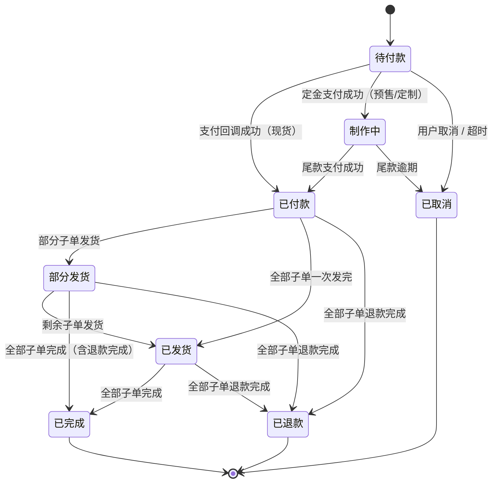
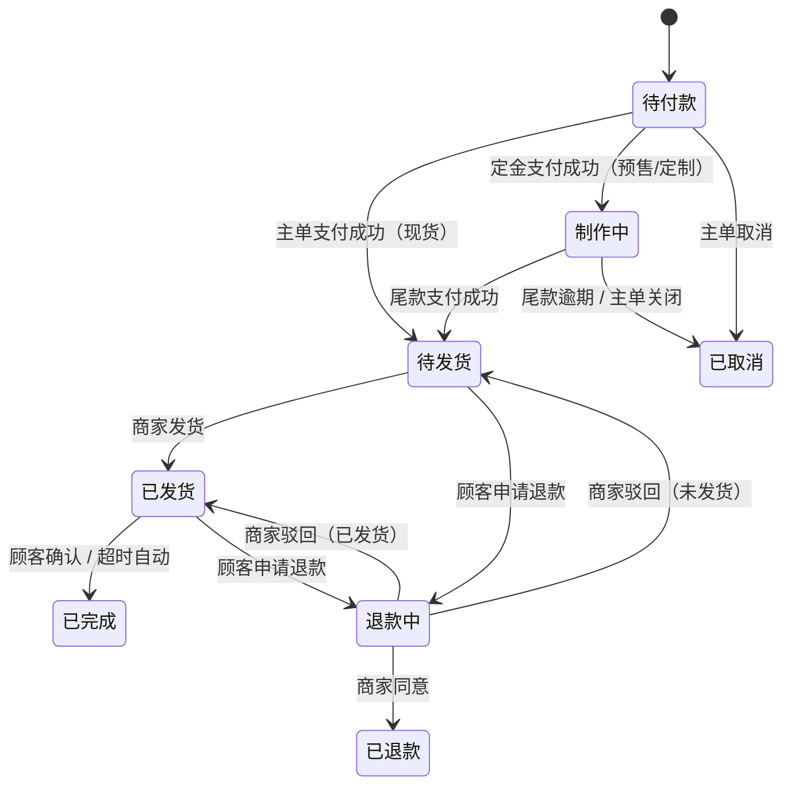
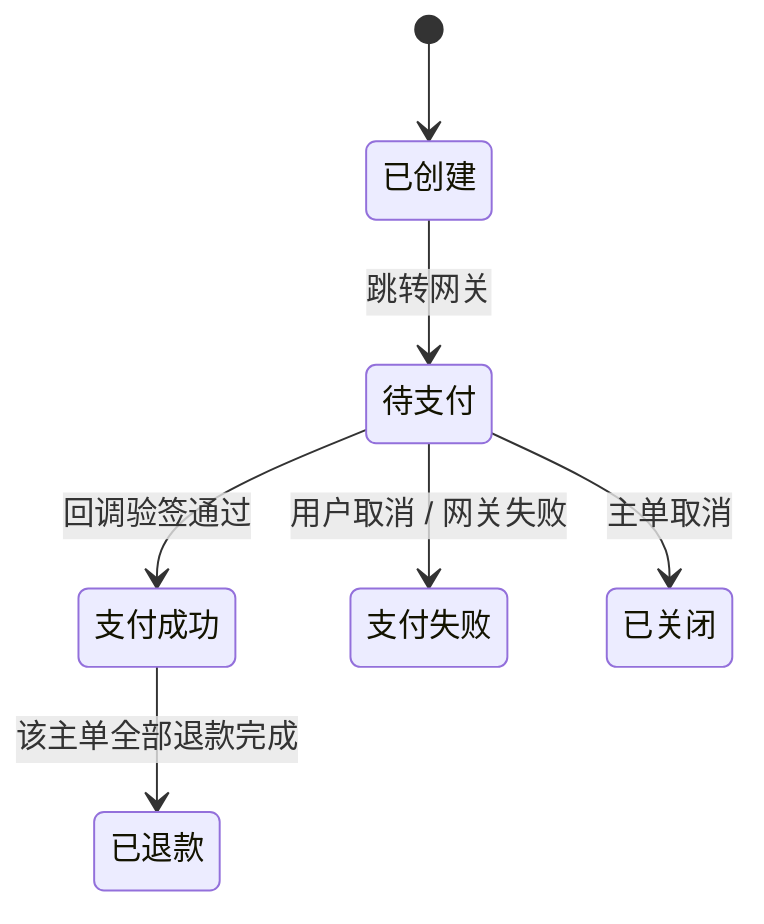
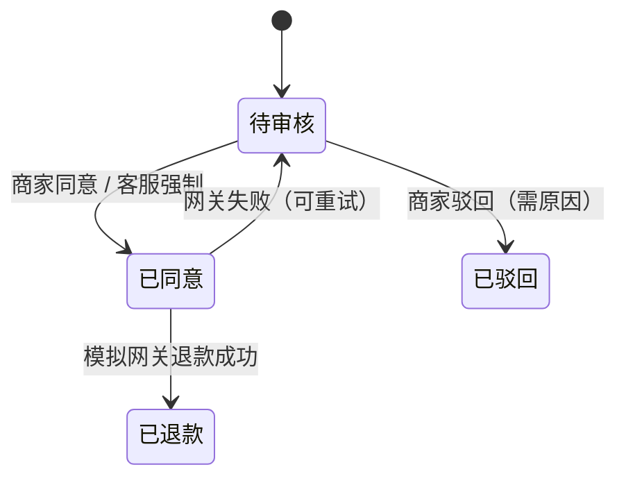
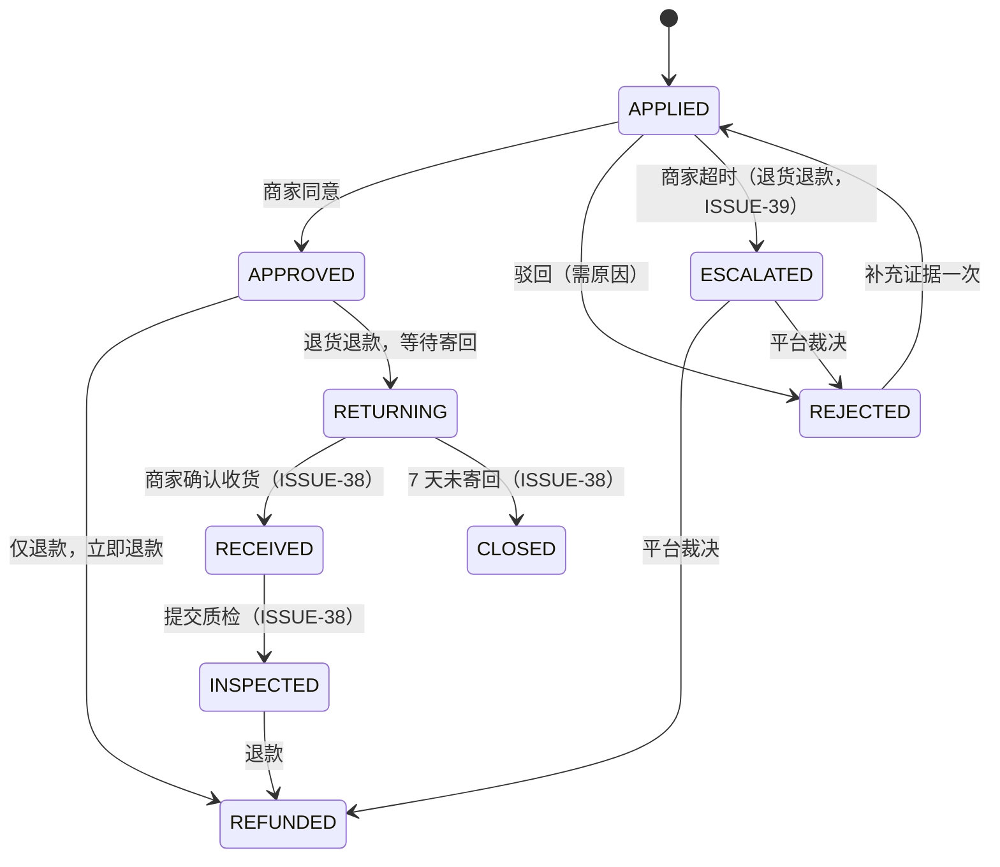
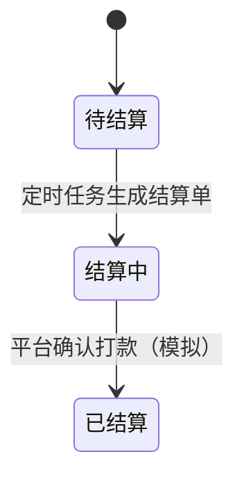
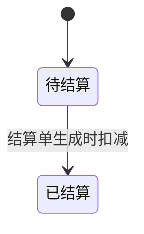

# 订单 / 支付 / 退款 / 结算状态机（G1）

一次结算 = 1 个主单 + N 个商家子单。**状态只存一份**：主单存支付与聚合状态，子单存履约状态；主单状态由子单重算，不手工改。

任何状态变更都必须：校验来源状态、写 `order_status_logs`、在同一事务内完成副作用（库存、券、邮件 outbox、主单重算）。

## 主单（顾客视角）



主单状态是**派生状态**，由子单聚合函数计算，不单独维护流转逻辑：

| 子单集合 | 主单 |
|---|---|
| 全部 PENDING_PAYMENT | 待付款 |
| 全部 PRODUCING | 制作中 |
| 全部 PENDING_SHIPMENT | 已付款 |
| 有 SHIPPED，也有 PENDING_SHIPMENT | 部分发货 |
| 全部 SHIPPED | 已发货 |
| 全部 COMPLETED | 已完成 |
| 全部 REFUNDED / CANCELLED | 已退款 / 已取消 |

## 子单（商家视角）



| 变更 | 触发者 | 前置条件 | 副作用 |
|---|---|---|---|
| 待付款 → 待发货 | 系统（支付回调） | 主单支付成功 | 扣减该子单下各 SKU 库存、清锁定 |
| 待付款 → 制作中 | 系统（定金回调） | 预售/定制订单定金支付成功 | 扣库存、写 `promised_ship_at = 支付时间 + 工期`、主单同步转制作中 |
| 制作中 → 待发货 | 系统（尾款回调） | 尾款支付成功 | 不重复扣库存、不发新邮件（尾款邮件除外） |
| 待付款 → 已取消 | 系统 / 用户 | 主单取消或超时（现货 15 分钟、预售/定制 24 小时） | 释放锁定库存、退券 |
| 制作中 → 已取消 | 系统（尾款逾期） | 通知后 7 天未付清尾款 | **定金不退、库存不回补、优惠券不退还**，关闭待支付单 |
| 待发货 → 已发货 | 商家 | 有发货权限、未在退款中 | 写 `shipments`、发发货邮件、重算主单 |
| 已发货 → 已完成 | 顾客 / 定时任务 | 已发货 | 置 `completed_at`、重算主单 |
| 待发货/已发货 → 退款中 | 顾客 | 无进行中的退款 | 建 `refunds`，通知商家 |
| 退款中 → 已退款 | 商家 / 平台客服 | 审核通过 | 调模拟网关退款、按 ADR-0004 处理库存、重算主单 |
| 退款中 → 原状态 | 商家 | 驳回且填原因 | 记日志，通知顾客 |

## 支付



支付挂在**主单**上，一笔支付覆盖全部子单。预售/定制订单有**两笔支付**：定金（`purpose=DEPOSIT`）与尾款（`purpose=BALANCE`），普通订单一笔（`purpose=FULL`）。

尾款口径：`balance = pay_amount - deposit`（定金与尾款之和恒等于订单应付，优惠已体现在应付里）。承诺发货前 3 天写 `balance_notified_at` / `balance_due_at = now + 7 天` 并发尾款邮件；`balance_due_at` 过后仍未付清，订单转已取消（`cancel_reason=BALANCE_OVERDUE`），定金不退。

回调处理顺序（缺一不可）：

1. 验签（HMAC-SHA256，密钥来自环境变量）
2. 时间窗校验（`|now - timestamp| < 5min`）
3. 幂等（`out_trade_no` 唯一索引 + 已处理标记）
4. 金额比对（回调金额 = 支付单金额 = 主单应付）
5. 状态校验（支付单 `PENDING` 才可转 `SUCCESS`）
6. 同一事务内：改支付单、改主单、把每个子单转待发货、逐 SKU 扣库存、写 outbox

## 退款（按子单）



- 粒度：**子单整单退**，金额 = 该子单实付（商品 - 分摊优惠 + 运费）
- 审核人：商家；平台客服可强制同意（纠纷介入），需记录原因
- 部分退款、单行退款首版不做

## 售后（子单完成后）



- 申请窗口：子单 `COMPLETED` 后 15 天内；定制订单原因只接受「质量问题 / 与描述不符」
- 一个子单同时只有一条售后单；被驳回后可用同一条记录补充证据一次
- 退款金额 = 子单实付 − 已退金额（整子单），底层复用旧退款执行与结算口径
- 未完成子单仍走旧的整单退款，完成后统一走售后单
- 退货退款：商家同意后 `return_due_at = now + 7 天`；顾客填寄回物流 → 商家确认收货（`inspect_due_at = now + 48 小时`）→ 质检
- 质检 `GOOD` 回补库存并退款；`DEFECTIVE` 不回补库存但仍退款；质检超时按 `GOOD` 自动退款
- 7 天未填寄回物流 → `CLOSED`；关闭后不再退款
- 商家 48 小时未审核：仅退款自动通过并退款，退货退款升级 `ESCALATED` 交平台客服
- 平台裁决必须填原因与责任归属（`MERCHANT` / `LOGISTICS` / `CUSTOMER`），责任归属决定退货运费由谁承担；自动裁决的流水与审计记 `SYSTEM`
- 质检为残次时默认责任归属商家，计入商家责任率

## 结算



可结算条件（三条同时满足）：

1. 子单状态 = `COMPLETED`
2. `completed_at <= now - 售后保护期（默认 7 天）`
3. 该子单未被任何结算单引用（唯一索引兜底）

金额口径：

```
gross      = 子单实付金额（商品金额 - 分摊优惠 + 运费）
commission = round(gross × 商家费率)
net        = gross - commission - refund - penalty
```

退款发生在结算前的，直接不计入；退款发生在结算后的，从下一期结算中扣减（`refund_cent` 字段）。
赔付取该子单 `PENDING` 的 `penalties` 之和（`penalty_cent`），生成结算时一并扣减并置为 `SETTLED`。

售后冻结：子单进入售后即置 `after_sales_frozen = 1`，生成结算时跳过；售后驳回或关闭后解冻（回到可结算），退款完成则子单转 `REFUNDED` 直接冲抵，不再进入结算。
对账任务每日校验「表头 = 明细之和」以及每行 `应结 = 成交 - 佣金 - 退款 - 赔付`，差异写 ERROR 日志告警。

## 工期超时赔付



- 触发：子单处于 `PRODUCING` / `PENDING_SHIPMENT`，已过 `promised_ship_at` 且未发货
- 基数：主单定金按子单实付占比分摊，`base = round(order.deposit_cent × sub.pay_amount_cent / order.pay_amount_cent)`
- 每天 `round(base × 5%)`，累计上限 `round(base × 50%)`；同子单同一天唯一（`uk_penalties_mo_day`）
- 漏跑可补：从「已记最大天数 + 1」补到当前逾期天数
- 一旦生成不因最终发货而撤回；只在结算时扣减，不向顾客钱包打款（首版）
- 子单被关闭（尾款逾期）后不再继续生成，已有赔付随订单作废

## 与库存的关系

| 时机 | 操作 | 说明 |
|---|---|---|
| 提交订单 | 逐个 SKU 锁定 `locked_stock += n` | 任一 SKU 失败则整单失败并回滚全部锁定 |
| 支付成功 | 逐个子单扣减 `stock -= n`、`locked_stock -= n` | 与主单转已付款同事务 |
| 取消/超时 | 释放 `locked_stock -= n` | 幂等：重复取消不重复释放 |
| 退款成功 | 未发货回补 `stock += n`；已发货不回补 | ADR-0004 |

## 定时任务清单

| 任务 | 频率 | 动作 |
|---|---|---|
| 订单超时取消 | 每 60 秒 | 扫 `PENDING_PAYMENT`：普通订单超 15 分钟、预售/定制超 24 小时未付定金，逐条取消并释放库存 |
| 尾款通知 | 每 60 秒 | 扫 `PRODUCING` 且未通知、`promised_ship_at - 3 天 <= now`，写 `balance_notified_at` / `balance_due_at`、发 outbox |
| 尾款逾期关闭 | 每 60 秒 | 扫 `PRODUCING` 且 `balance_due_at < now`，关闭订单（定金不退、库存不回补、券不退还） |
| 自动确认收货 | 每小时 | 扫 `SHIPPED` 且 `shipped_at < now - 15d` 的子单，转完成并重算主单 |
| 工期赔付 | 每 60 秒 | 扫 `PRODUCING` / `PENDING_SHIPMENT` 且 `promised_ship_at < now` 的未发货子单，按天补 `penalties`（5%/天，上限 50% 定金） |
| 售后超时 | 每 60 秒 | 商家 48 小时未审核：仅退款自动通过、退货退款升级平台；7 天未填寄回物流关闭；收货 48 小时未质检按良品自动退款 |
| 结算对账 | 每日 03:30 | 校验结算表头与明细之和、每行 `应结 = 成交 - 佣金 - 退款 - 赔付`，差异告警 |
| 结算生成 | 每日 | 汇总可结算子单，按商家生成结算单（扣佣金、退款与赔付） |
| 结算对账 | 每日 | 校验 `Σ settlement_items` 与已完成子单一致，差异告警 |

超时取消用「扫描 + 条件更新」而非延迟队列：链条短、可重跑、出问题好查（ADR-0002 同理）。
