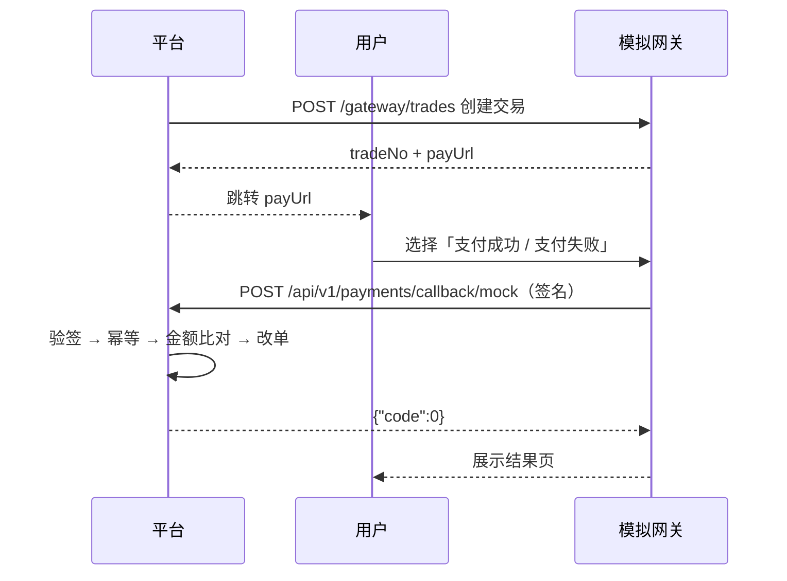

# 05 模拟支付网关

自研网关，替代真实支付通道。协议故意做成「和真实通道同构」：创建交易 → 用户确认 → 异步回调 → 验签入账 → 可退款 → 可对账。

---

## 一、参与方与流程



---

## 二、创建交易（平台 → 网关）

```http
POST /gateway/trades
Content-Type: application/json

{
  "outTradeNo": "PAY202610270001",
  "amountCent": 32920,
  "subject": "KDShop 订单 KD202610270001",
  "notifyUrl": "http://backend:8080/api/v1/payments/callback/mock",
  "expireAt": "2026-10-27T14:20:00+08:00",
  "timestamp": 1793529600000,
  "nonce": "a1b2c3d4",
  "sign": "9f2c..."
}
```

| 字段 | 必填 | 说明 |
|---|---|---|
| outTradeNo | 是 | 平台支付单号，全局唯一，幂等键 |
| amountCent | 是 | 整数分，与平台支付单一致 |
| subject | 是 | 展示用标题，最长 64 |
| notifyUrl | 是 | 回调地址，只允许配置白名单内的域名 |
| expireAt | 是 | 超过该时间网关拒绝支付 |
| timestamp | 是 | 毫秒时间戳 |
| nonce | 是 | 随机串，8–32 位，5 分钟内不可重复 |
| sign | 是 | 见「签名算法」 |

**响应 201**

```json
{ "tradeNo": "GT202610270001", "outTradeNo": "PAY202610270001",
  "payUrl": "/mock-pay/PAY202610270001", "expireAt": "2026-10-27T14:20:00+08:00" }
```

同一 `outTradeNo` 重复创建：返回首次的 `tradeNo` 与 `payUrl`，不新建交易。

---

## 三、用户支付页

`GET /mock-pay/{outTradeNo}` 返回一个极简页面：

- 展示金额、订单标题、倒计时
- 两个按钮：**模拟支付成功** / **模拟支付失败**
- 点击后网关生成回调（带签名），POST 到 `notifyUrl`
- 页面展示回调结果，便于演示「验签失败」「重复回调」等场景

调试参数：`?scenario=sign_invalid` 可强制发出错误签名，`?scenario=duplicate` 可连发两次回调。

---

## 四、回调（网关 → 平台）

```http
POST /api/v1/payments/callback/mock
Content-Type: application/json

{
  "outTradeNo": "PAY202610270001",
  "tradeNo": "GT202610270001",
  "amountCent": 32920,
  "status": "SUCCESS",
  "paidAt": "2026-10-27T14:07:12+08:00",
  "timestamp": 1793529700000,
  "nonce": "e5f6g7h8",
  "sign": "3a7b..."
}
```

**平台响应**（无论成功失败都返回 200，业务结果看 `code`）：

```json
{ "code": 0, "message": "ok" }
```

网关收到非 200 或 `code != 0` 会重试：间隔 1s、5s、30s、5min、30min，最多 5 次。

---

## 五、签名算法

1. 取所有**非空**参数（不含 `sign`），按 key 的字典序升序排列
2. 拼成 `k1=v1&k2=v2&...`（值不做 URL 编码，原样拼接）
3. 末尾追加 `&key={secret}`，`secret` 来自环境变量 `PAY_GATEWAY_SECRET`
4. 对整串做 **HMAC-SHA256**，输出小写十六进制

```text
待签串：amountCent=32920&nonce=e5f6g7h8&outTradeNo=PAY202610270001&paidAt=...&status=SUCCESS&timestamp=1793529700000&tradeNo=GT202610270001&key=xxxxx
签名：  hex(hmac_sha256(待签串, secret))
```

**验证方必须用常量时间比较**，避免时序侧信道。

---

## 六、平台侧处理流程

| 步骤 | 校验 | 失败返回 |
|---|---|---|
| 1 | 验签 | 40008 |
| 2 | `|now - timestamp| < 5min` | 40008（视为重放） |
| 3 | `nonce` 未用过（Redis SETNX，TTL 10min） | 40008 |
| 4 | `outTradeNo` 存在且属于本平台 | 40007 |
| 5 | 回调金额 = 支付单金额 = 主单应付 | 40009 |
| 6 | 支付单状态为 `PENDING` | 幂等返回 `{"code":0}` |
| 7 | 事务：支付单转 `SUCCESS`、主单转 `PAID`、子单转 `PENDING_SHIPMENT`、逐 SKU 扣库存、写 outbox | — |

> 第 6 步是关键：已处理过的回调直接返回成功，绝不重复扣库存或重复发邮件。

---

## 七、退款

```http
POST /gateway/refunds
{ "outRefundNo": "RF202610270001", "tradeNo": "GT202610270001",
  "amountCent": 24320, "reason": "用户申请退款",
  "timestamp": 1793530000000, "nonce": "i9j0k1l2", "sign": "..." }
```

**响应 200**

```json
{ "refundNo": "GR202610280001", "outRefundNo": "RF202610270001",
  "status": "SUCCESS", "refundedAt": "2026-10-28T09:30:00+08:00" }
```

模拟网关的退款是同步成功的；真实通道通常是异步通知，所以平台侧保留了 `REFUNDING → REFUNDED` 两态，换成真实通道时不用改状态机。

---

## 八、对账

网关提供按日对账文件（模拟环境为接口）：

```http
GET /gateway/reconcile?date=2026-10-27
```

```json
{ "date": "2026-10-27", "count": 96, "totalAmountCent": 1280000,
  "trades": [ { "outTradeNo": "PAY202610270001", "amountCent": 32920, "status": "SUCCESS" } ] }
```

平台每日任务比对：网关侧成功笔数/金额 vs 平台 `payments` 表 `SUCCESS` 记录，差异写入告警日志。

---

## 九、测试用例（必须覆盖）

| 场景 | 构造方式 | 期望 |
|---|---|---|
| 正常支付 | 正常回调 | 订单转已付款，库存扣减，邮件入队 |
| 签名错误 | 改一个字段 | 40008，订单不变 |
| 金额篡改 | `amountCent` 改小 | 40009，订单不变 |
| 重放 | `timestamp` 改到 10 分钟前 | 40008 |
| 重复回调 | 连发两次相同请求 | 第二次返回 `code:0`，库存只扣一次 |
| 超时未付 | 不回调，等 15 分钟 | 订单转已取消，库存释放 |
| 退款 | 调退款接口 | 子单转已退款，库存按 ADR-0004 处理 |
| 对账差异 | 手工改一条支付记录 | 对账任务报差异并告警 |

---

## 十、换成真实通道时改哪里

只有一处：`PaymentChannel` 接口的三个方法 `createTrade`、`verifyCallback`、`refund`。

- 签名算法换成对方文档里的（微信 V3 用证书 + SHA256-RSA，支付宝用 RSA2）
- 回调字段换名字，验签逻辑不同
- `PENDING → SUCCESS/FAILED` 的状态机不变

这也是为什么平台侧从不信任前端回跳结果——只认异步回调。
